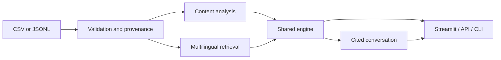

# NewsBot Intelligence System 2.0

**Final Capstone · ITAI 2373 · Natural Language Processing · Houston Community College**

**José Miguel Tuozzo Izaguirre | JoseGroup | November 2026**

[](https://github.com/jtuozzo1616/Final-Jose-Group-NewsBot-Intelligence-System/actions/workflows/newsbot2-final.yml)

An evidence-first, local-first news intelligence workspace that extends the historical BBC midterm classifier into a modular NLP platform. It supports article analysis, extractive summarization, multilingual retrieval, cited conversational exploration, and an interactive web interface without a paid API.

## Instructor review — start here

| Deliverable | Open directly |
|---|---|
| Technical documentation | [PDF — technical report](final-newsbot-2.0/submission/FP_TechnicalDoc_JoseMiguelTuozzo_JoseGroup_ITAI2373.pdf) |
| Executive summary | [PDF — executive summary](final-newsbot-2.0/submission/FP_ExecutiveSummary_JoseMiguelTuozzo_JoseGroup_ITAI2373.pdf) |
| Final presentation | [PowerPoint — updated rubric edition (18 slides after verified generation)](final-newsbot-2.0/submission/FP_Presentation_JoseMiguelTuozzo_JoseGroup_ITAI2373.pptx) |
| Reflective journal | [PDF — 3-page rubric reading draft after verified generation](final-newsbot-2.0/submission/FP_ReflectiveJournal_JoseGroup_ITAI2373.pdf) |
| GitHub submission links | [PDF](final-newsbot-2.0/submission/FP_GitHub_Links_ITAI2373.pdf) |
| Rubric and evidence | [Final submission review](final-newsbot-2.0/docs/FINAL_SUBMISSION_REVIEW.md) |
| Reproduce the system | [Quick start](final-newsbot-2.0/README.md) · [Verified CI run](https://github.com/jtuozzo1616/Final-Jose-Group-NewsBot-Intelligence-System/actions/runs/45680349376) |
| Research artifacts | [Results](final-newsbot-2.0/artifacts/) · [Research code](final-newsbot-2.0/run_research.py) |

The detailed rubric requires 15–20 slides with notes and a three-page reflection. The new deliverables are generated and verified by the [rubric document workflow](https://github.com/jtuozzo1616/Final-Jose-Group-NewsBot-Intelligence-System/actions/workflows/rubric-deliverables.yml). The student should personally approve the condensed journal; the original five-page reading copy is preserved. See the submission index for provenance.

## Final execution evidence

- [Final executable notebook](final-newsbot-2.0/Final_NewsBot_2.0.ipynb) — [open in Colab](https://colab.research.google.com/github/jtuozzo1616/Final-Jose-Group-NewsBot-Intelligence-System/blob/main/final-newsbot-2.0/Final_NewsBot_2.0.ipynb) after installing the project dependencies and cloning the repository.
- [Latest evidence workflow](https://github.com/jtuozzo1616/Final-Jose-Group-NewsBot-Intelligence-System/actions/workflows/newsbot-evidence.yml) — executes the notebook, real Chromium interactions and neural-model tests. Results must be checked before claiming success.
- [Deployment instructions](final-newsbot-2.0/docs/DEPLOYMENT.md) — requires hosting-account authorization; public URL pending verification.
- [Oral defense and live demonstration guide](final-newsbot-2.0/docs/ORAL_DEFENSE.md).
- [Detailed Canvas verification status](final-newsbot-2.0/docs/CANVAS_VERIFICATION.md).

## Detailed rubric alignment (November 25)

- [Advanced analytics: LDA and NMF, clustering, temporal sentiment, co-mentions and structured queries](final-newsbot-2.0/newsbot2/advanced.py).
- [Executed notebook and browser evidence](final-newsbot-2.0/evidence/) — prior run verified all five tabs, actual 384-dimensional multilingual embeddings and three ES→EN translations.
- [Real historical BBC final-pipeline evaluation workflow](https://github.com/jtuozzo1616/Final-Jose-Group-NewsBot-Intelligence-System/actions/workflows/rubric-verification.yml) — results pending until successful execution; no raw copyrighted text published.

## Rubric documentation and tutorials

[Detailed 200-point crosswalk](final-newsbot-2.0/docs/CANVAS_VERIFICATION.md) · [Seven tutorial notebooks](final-newsbot-2.0/notebooks/) · [Technical specification](final-newsbot-2.0/docs/technical_documentation.md) · [API reference](final-newsbot-2.0/docs/api_reference.md) · [User guide and FAQ](final-newsbot-2.0/docs/user_guide.md) · [Business case and ROI](final-newsbot-2.0/docs/business_analysis.md) · [15-minute defense](final-newsbot-2.0/docs/ORAL_DEFENSE.md).

## System architecture



| Required capability | Main implementation |
|---|---|
| Advanced analysis | [Classification, NMF topics, sentiment, entities](final-newsbot-2.0/newsbot2/analysis.py) |
| Understanding and generation | [Extractive MMR summaries](final-newsbot-2.0/newsbot2/analysis.py), [ranked search and relevant source windows](final-newsbot-2.0/newsbot2/retrieval.py) |
| Multilingual intelligence | [Language detection, lexical pivot, optional Argos translation](final-newsbot-2.0/newsbot2/language.py); optional multilingual embeddings |
| Conversational interface | [Grounded chat, citations, follow-up, abstention](final-newsbot-2.0/newsbot2/chat.py) |
| Web frontend bonus | [Five-tab Streamlit application](final-newsbot-2.0/app.py) |
| Research bonus | [Controlled retrieval and classification experiments](final-newsbot-2.0/run_research.py), [paired ablation and language holdout](final-newsbot-2.0/run_robustness.py) |

## Verified experimental evidence

| Evaluation | Result | Scope |
|---|---:|---|
| Final automated tests | **27 passed** | Offline core and API regression tests |
| Word baseline macro-F1 | 0.5371 | 30 fictional records, same stratified folds |
| Pivot word macro-F1 | 0.5720 | Same controlled experiment |
| Pivot + character macro-F1 | **0.6143** | +0.0772 absolute F1 vs baseline |
| Retrieval MRR@3 | **1.000 vs 0.625** | 24 selected fictional probes, with vs without pivot |
| Historical BBC holdout | **96.18% accuracy / 0.9605 macro-F1** | 288 historical articles; midterm only |

[Verified CI](https://github.com/jtuozzo1616/Final-Jose-Group-NewsBot-Intelligence-System/actions/runs/45679903622) · [Permanent verified summary](final-newsbot-2.0/artifacts/verified_final_summary.json) · [Evaluation methodology and limits](final-newsbot-2.0/docs/ARCHITECTURE_AND_LIMITS.md).

The synthetic results are controlled functional experiments, not real-world accuracy. The retrieval probes were constructed with knowledge of the corpus. Translation and learned multilingual embeddings require installed model assets; the default system uses transparent CPU fallbacks. This is a capstone prototype, not a deployed or independently validated newsroom product.

## Quick demonstration

```bash
git clone https://github.com/jtuozzo1616/Final-Jose-Group-NewsBot-Intelligence-System.git
cd Final-Jose-Group-NewsBot-Intelligence-System/final-newsbot-2.0
python -m pip install -r requirements-dev.txt
python -m pytest tests -q
python run_research.py
streamlit run app.py
```

Open the local Streamlit URL printed in the terminal. Explore **Command Center**, **Article Lab**, **Search & Languages**, **Grounded Chat**, and **Research Lab**. See the [quick start](final-newsbot-2.0/README.md) for command-line and API examples.

## Repository map

- [final-newsbot-2.0/](final-newsbot-2.0/) — final source, tests, data, experiments and current deliverables.
- [submission/](final-newsbot-2.0/submission/) — single authoritative reviewer-facing document index.
- [Historical midterm](MIDTERM.md) — eight original NLP modules and verified BBC evidence (preserved for continuity).
- [Original executed notebook](docs/NewsBot_Executed_Results.ipynb) and [historical outputs](outputs/) — prior independent evaluation, not final scores.
- [Contribution record](final-newsbot-2.0/docs/CONTRIBUTIONS.md) — student-supplied reflection and evidence boundaries.

The grade and bonus awards remain the instructor's decision. The two separately specified Canvas instruction downloads were not provided; the review map follows the available assignment overview.
