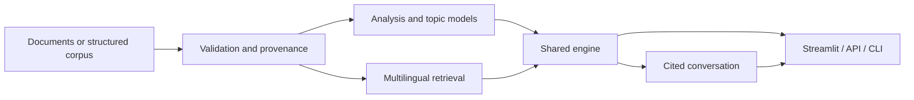

# NewsBot Intelligence System 2.0

**Final Capstone · ITAI 2373 — Natural Language Processing · Houston Community College**

José Miguel Tuozzo Izaguirre · JoseGroup · November 2026

[](https://final-jose-group-newsbot-intelligence-system-al984gd7vc9uzqmek.streamlit.app/) [](https://colab.research.google.com/github/jtuozzo1616/Final-Jose-Group-NewsBot-Intelligence-System/blob/main/final-newsbot-2.0/evidence/NewsBot_JoseT_2_0_Master_Colab.ipynb) [](https://github.com/jtuozzo1616/Final-Jose-Group-NewsBot-Intelligence-System/actions/runs/45698267399)

An evidence-first NLP workspace integrating document analysis, classification, topic discovery, multilingual retrieval, neural editorial drafts and source-grounded conversation. The default hosted application uses a lightweight CPU pipeline; neural experiments are reproducible separately.

## Instructor review — start here

| Resource | Access |
|---|---|
| **Live web application** | [Open NewsBot](https://final-jose-group-newsbot-intelligence-system-al984gd7vc9uzqmek.streamlit.app/) |
| **Master notebook — executed in Google Colab** | [View saved results](final-newsbot-2.0/evidence/NewsBot_JoseT_2_0_Master_Colab.ipynb) · [Open in Colab](https://colab.research.google.com/github/jtuozzo1616/Final-Jose-Group-NewsBot-Intelligence-System/blob/main/final-newsbot-2.0/evidence/NewsBot_JoseT_2_0_Master_Colab.ipynb) |
| **Required individual portfolio** | [ITAI2373-NewsBot-Final](https://github.com/jtuozzo1616/Jose-Tuozzo-AI-Portfolio/tree/main/ITAI2373-NewsBot-Final) |
| Academic submission | [All five deliverables](final-newsbot-2.0/submission/) |
| Detailed grading audit | [200-point rubric and bonus evidence](final-newsbot-2.0/docs/CANVAS_VERIFICATION.md) |
| Quality assurance | [38 passing tests and dependency verification](https://github.com/jtuozzo1616/Final-Jose-Group-NewsBot-Intelligence-System/actions/runs/45698267399) · [Evidence index](final-newsbot-2.0/evidence/) |

The student confirmed that the hosted application opens and successfully imports PDF and Word after the dependency fix. Independent external browsing could not retrieve the Streamlit page; public access without an account should be checked in a private browser. The master notebook is the byte-identical student-supplied Colab file: eight sections, ten executed code cells, 13 PNG outputs and no saved errors. Its pinned earlier revision passed 33 tests; the latest software CI passed 38.

## Capabilities

| Module | Implementation |
|---|---|
| A — Advanced content analysis | Classification with fixed category hierarchy, LDA/NMF, K-means, sentiment evolution and source-linked entity co-mentions |
| B — Language understanding and generation | MMR extractive summaries, template enhancement, optional FLAN-T5, TF-IDF/LSA/MiniLM search and query expansion |
| C — Multilingual intelligence | EN/ES/FR/DE language hints, lexical pivot, optional real neural embeddings and ES→EN translation, shared-event coverage comparison |
| D — Conversation | Intent routing, filters, bounded follow-up, cited excerpts, abstention and report export |
| Web application | Five interactive tabs, batch processing and import of PDF, DOCX, TXT, Markdown, HTML, CSV, JSON and JSONL |



## Verified evidence

| Evaluation | Result | Scope |
|---|---:|---|
| Latest automated tests | **38 passed** | CI; includes PDF/DOCX ingestion |
| Master Colab | **8/8 sections** | Earlier pinned revision, 33 tests in Colab |
| Final BBC classification | **90.8% accuracy / 0.9079 macro-F1** | 250 real historical articles, 3-fold CV |
| Historical midterm | 96.18% accuracy / 0.9605 macro-F1 | 288 held-out historical BBC records, separate experiment |
| Paired synthetic classification | 0.5371 → 0.6143 macro-F1 | 30 fictional records; word baseline vs pivot + character features |
| Synthetic retrieval | 0.625 → 1.000 MRR@3 | 24 selected fictional probes, no pivot vs pivot |
| Neural retrieval | 0.625 → 0.750 MRR@3 | Four separate selected fictional probes, lexical vs MiniLM |
| Neural translation / generation | 3 ES→EN translations / 3 FLAN-T5 drafts | Actual model inference, not human-rated quality |

See [evidence index](final-newsbot-2.0/evidence/README.md) for exact run links and data scope. The default corpus is fictional; the real BBC data is historical, not a live news feed. Source citation establishes provenance, not truth. Neural drafts are unverified editorial suggestions. The public demo is not a production-grade newsroom service.

## Run locally

```bash
git clone https://github.com/jtuozzo1616/Final-Jose-Group-NewsBot-Intelligence-System.git
cd Final-Jose-Group-NewsBot-Intelligence-System/final-newsbot-2.0
python -m pip install -r requirements-dev.txt
python -m pytest tests -q
python run_research.py
streamlit run app.py
```

## Repository guide

- [Implementation and setup](final-newsbot-2.0/README.md) · [User guide](final-newsbot-2.0/docs/user_guide.md) · [API](final-newsbot-2.0/docs/api_reference.md) · [Deployment](final-newsbot-2.0/docs/DEPLOYMENT.md)
- [Seven tutorial notebooks](final-newsbot-2.0/notebooks/) (retained for the rubric) · [Executed evidence](final-newsbot-2.0/evidence/) · [Research code](final-newsbot-2.0/run_research.py)
- [Technical architecture](final-newsbot-2.0/docs/technical_documentation.md) · [Business case](final-newsbot-2.0/docs/business_analysis.md) · [Contribution record](final-newsbot-2.0/docs/CONTRIBUTIONS.md)
- [Historical midterm](MIDTERM.md) — archived foundation and separate metrics.

The course requires the actual individual contribution record and presentation/demo requirements; the grade and bonus awards remain the instructor's decision.
